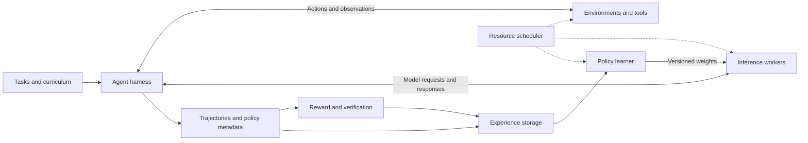

# Reading Guide

This guide is an editorial synthesis of the [catalog](../README.md), not a benchmark ranking. Each route selects papers around a concrete design question; the catalog and [audit](SOURCE_AUDIT.md) specify the reviewed versions.

## A First Reading Route

| Step | Paper | What to extract |
| --- | --- | --- |
| 1 | [HybridFlow](https://arxiv.org/abs/2409.19256) | Separate algorithm control flow from distributed model execution; locate training/generation resharding costs. |
| 2 | [AReaL](https://arxiv.org/abs/2505.24298) | Follow the rollout queue and policy-update loop; identify how staleness is measured and controlled. |
| 3 | [AgentRL](https://arxiv.org/abs/2510.04206) | Add multi-turn, multi-task environments; examine the function-call interface and environment ownership. |
| 4 | [Agent Lightning](https://arxiv.org/abs/2508.03680) and [v1.0](https://arxiv.org/abs/2608.17528) | Compare a unified training interface with a harness-owned interaction loop; track tokens, samples, and advantages. |
| 5 | [RollArt](https://arxiv.org/abs/2512.22560) | Separate inference, environments, and rewards by hardware and execution characteristics. |

## System Map

This is a conceptual map of concerns across the literature, not the exact architecture of any one framework. Components can be colocated or separated.

## Routes by Engineering Problem

| Problem | Read together | Comparison questions |
| --- | --- | --- |
| Existing agents are hard to train | [Lightning v1.0](https://arxiv.org/abs/2608.17528), [SkyRL-Agent](https://arxiv.org/abs/2511.16108), [Molt](https://arxiv.org/abs/2607.21653) | Who owns the interaction loop? How are tokenization, context compaction, and request-to-trajectory mapping handled? |
| Long rollouts leave workers idle | [AReaL](https://arxiv.org/abs/2505.24298), [StreamRL](https://arxiv.org/abs/2504.15930), [ROLL Flash](https://arxiv.org/abs/2510.11345), [RollPacker](https://arxiv.org/abs/2509.21009) | Does the method change synchronization, scheduling, or sample grouping? Which on-policy assumptions remain? |
| Asynchrony changes learning behavior | [DORA](https://arxiv.org/abs/2604.26256), [Missing Old Logits](https://arxiv.org/abs/2605.12070), [SAO](https://arxiv.org/abs/2607.07508) | What policy version generated each token? Are old probabilities available? Does the optimizer require a sample group? |
| Environment work dominates cost | [AgentFly](https://arxiv.org/abs/2507.14897), [VenusRL](https://arxiv.org/abs/2610.03286), [Infrastructure Tax](https://arxiv.org/abs/2607.01415) | What is acquired per tool call, per rollout, or globally? How are admission, reuse, memory, and startup measured? |
| Inference placement loses cached prefixes | [WAR](https://arxiv.org/abs/2607.17299), [VenusRL](https://arxiv.org/abs/2610.03286) | Is the scheduling target token throughput, cache reuse, trajectory completion, or completion of a training group? |
| Training and rollout need different hardware | [ReaL](https://arxiv.org/abs/2406.14088), [RLinf](https://arxiv.org/abs/2509.15965), [RollArt](https://arxiv.org/abs/2512.22560) | Which stage can scale independently? What are the costs of parameter transfer, context switching, and resource migration? |
| Executable training tasks are scarce | [SWE-Gym](https://arxiv.org/abs/2412.21139), [SWE-smith](https://arxiv.org/abs/2504.21798), [SWE-Factory](https://arxiv.org/abs/2506.10954) | Are environments reproducible? Are tests reliable? How are task construction and evaluation split from policy training? |
| Multiple policies compete for resources | [FlexMARL](https://arxiv.org/abs/2602.09578) | How are inter-agent and intra-agent requests balanced? When are training states swapped? |
| Visual or embodied tasks add new costs | [AsyncWebRL](https://arxiv.org/abs/2606.05597), [RLinf-VLA](https://arxiv.org/abs/2510.06710) | How much cost comes from screenshots, rendering, simulator steps, inference, and policy updates? |
| Learning must connect to deployed agents | [AReaL 2.0 architecture](https://arxiv.org/abs/2607.01120), [RAGEN-2](https://arxiv.org/abs/2604.06268) | What data protocol and online diagnostics are needed? Which parts are implemented, proposed, or only studied in controlled tasks? |

## A Comparison Worksheet

Use matched workloads before comparing systems. The following is a suggested evaluation worksheet, not a claim that every listed paper reports these measurements.

| Dimension | Record |
| --- | --- |
| Learning target | Model and tokenizer revision, algorithm, reward definition, target held-out task performance |
| Workload | Task mix, environment version, trajectory turn/token distribution, context lengths, timeout policy |
| Resources | GPU type/count, CPU cores, RAM, storage, network, inference/training split |
| Efficiency | Time and cost to a fixed quality target, end-to-end updates per hour, completed trajectories per hour |
| Tail behavior | Median and tail trajectory latency, group completion time, environment startup and tool latency |
| Correctness | Behavior-policy version, old log-probability provenance, staleness distribution, discarded samples |
| Reliability | Retry rules, failed environment handling, checkpoint recovery, reproducibility of task state |
| Overheads | Weight synchronization, resharding, serialization, experience memory, KV-cache recomputation |

A reported speedup against one baseline is not a transferable ranking. Synchronous and asynchronous systems can consume different samples or require different numbers of updates to reach the same task quality.

## Possible Research Questions

The questions below are editorial directions suggested by the papers, not established gaps claimed to be unsolved everywhere.

- Can scheduling optimize **time to useful policy updates** while preserving environment and policy-version constraints, rather than only token throughput? Start with VenusRL, WAR, and DORA.
- How should sandbox admission and reuse coordinate with rollout backpressure and trajectory length? Start with AgentFly, RollArt, and Infrastructure Tax.
- What is the lowest-cost way to preserve behavior-policy and training-side probability provenance across partial rollouts? Start with Missing Old Logits and DORA.
- Can a shared trajectory interface preserve context-compaction and token identities across existing agent harnesses? Start with Lightning v1.0 and Molt.
- Which online diagnostics distinguish higher rollout throughput from a deteriorating training signal? Start with RAGEN-2 and the AReaL 2.0 architecture paper.
